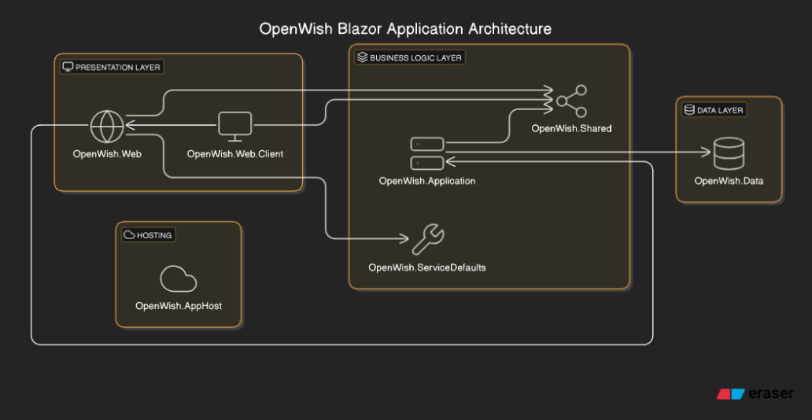

# Development Guide

## Solution Design

<sub><i>Generated by eraser.io/diagramgpt</i></sub>



* `OpenWish.AppHost` - .NET Aspire Host project and contains the main entry point for the application when debugging locally. See [Aspire secrets](#aspire-secrets) for setting up required dev-time secrets.
* `OpenWish.Data` - Contains the EntityFramework Core context and models for the application.
* `OpenWish.Web` - Blazor Server project and API host for the application. This is what eventually is hosted as the main application. 
* `OpenWish.Shared` - Shared models and interfaces between the `OpenWish.Web` and `OpenWish.Web.Client` projects - enabling Blazor Interactive Auto render mode where server renders the initial page using its implementation of `I{Service}` services, and these assemblies are downloaded to client via web assembly to enable client-side interactivity after initial rendering. 
* `OpenWish.Application` - Contains the application services and business logic for the application.
* `OpenWish.ServiceDefaults` - supports the .NET Aspire Host bootstrapping.

Friend invitations to an existing account create a friend request, matching
email addresses without regard to casing. Pending email invitations are reused
for the same sender and address (also case-insensitively), and an accepted
invitation is cleared even when a friendship was established earlier.

## Aspire Secrets

To run a local PostgreSQL instance, you must give a username & password. Use dotnet user secrets for this.

```bash
cd src/OpenWish.AppHost
dotnet user-secrets set Parameters:sqlUser "openwish"
dotnet user-secrets set Parameters:sqlPassword "D0 not use this in prod!"
# (no really, don't)
```

The secret will be passed into `OpenWish.Web` automatically (well, from Aspire).

## Optional Google login

Create an OAuth 2.0 Client ID for a Web application in Google Cloud, then add
the OpenWish callback URL as an authorized redirect URI. Use the HTTPS
`openwish-web` endpoint shown by the Aspire dashboard followed by
`/signin-google`; with the committed local launch profile, this is:

```text
https://localhost:7054/signin-google
```

Store the client credentials in the AppHost user-secrets store:

```bash
cd src/OpenWish.AppHost
dotnet user-secrets set "Authentication:Google:ClientId" "<google-client-id>"
dotnet user-secrets set "Authentication:Google:ClientSecret" "<google-client-secret>"
```

The AppHost forwards both values to `OpenWish.Web`. Google login remains
disabled when either value is missing. Restart the AppHost after changing
these secrets.

## Optional connected apps

Register a connected app for local testing in the AppHost user secrets. The
AppHost forwards every `OpenWishSettings:Integrations` value to the web app:

```bash
cd src/OpenWish.AppHost
dotnet user-secrets set "OpenWishSettings:Integrations:Apps:0:ClientId" "studio"
dotnet user-secrets set "OpenWishSettings:Integrations:Apps:0:ClientSecret" "<at-least-32-random-characters>"
dotnet user-secrets set "OpenWishSettings:Integrations:Apps:0:DisplayName" "Studio Notebook"
dotnet user-secrets set "OpenWishSettings:Integrations:Apps:0:RedirectUris:0" "http://localhost:3001/api/integrations/openwish/callback"
```

See [Connected apps](INTEGRATIONS.md) for the OAuth flow and API contract.
`OpenWish.Web.Tests` exercises that contract end to end against PostgreSQL. It
starts a disposable container, so Docker must be running for `dotnet test`;
set `OPENWISH_TEST_POSTGRES` to a connection string to reuse an existing
dedicated test server instead, never a development or production database.

To validate the actual companion rather than the fake app, run
`scripts/verify-integrated-client.sh /absolute/path/to/the-atelier`.
It uses an isolated HTTPS Compose stack and synthetic accounts; see the
[verification details](INTEGRATIONS.md#verification) for prerequisites,
cookie coverage, and the companion's current lockfile limitation.

## Optional OpenTelemetry export

OpenWish records ASP.NET Core and outbound HTTP traces plus runtime, ASP.NET
Core, and HTTP client metrics. Export is disabled unless an OTLP endpoint is
configured. To send traces and metrics to separate OTLP/HTTP receivers in a
local observability stack, pass the standard OpenTelemetry settings to the
AppHost:

```bash
cd src
dotnet run --project OpenWish.AppHost -- \
  --OTEL_EXPORTER_OTLP_TRACES_ENDPOINT=http://localhost:4318/v1/traces \
  --OTEL_EXPORTER_OTLP_METRICS_ENDPOINT=http://localhost:4318/v1/metrics \
  --OTEL_EXPORTER_OTLP_TRACES_PROTOCOL=http/protobuf \
  --OTEL_EXPORTER_OTLP_METRICS_PROTOCOL=http/protobuf
```

Either signal can be configured independently. `OTEL_EXPORTER_OTLP_ENDPOINT`
remains supported when one collector endpoint handles traces, metrics, and
logs. Docker-based runs can provide the same variables through their
environment. The agent Compose stack maps `host.docker.internal` to the Docker
host so it can reach a collector running there.

## EntityFramework Core Changes

The EFCore context is found in the [OpenWish.Data](./src/OpenWish.Data) project as a reference, but the [OpenWish.Web](./src/OpenWish.Web) project owns running the Migrations on Startup. 

### Add Migration

After adjusting EF models and you want to stage a new DB migration, run:

```bash
# from project root, change name of 'Initial' as needed
dotnet ef migrations add Initial -p src/OpenWish.Data -s src/OpenWish.Web
```

> Note: may need `dotnet tool install --global dotnet-ef` if you don't have the EF Core tools installed.

## Secrets Management

Certain components require secret values that shouldn't be in source control -- ever. To solve this for local development, use `dotnet user-secrets`. 

For example, you'll need to set these for Email sending:

```bash
cd src/OpenWish.AppHost

dotnet user-secrets set OpenWishSettings:EmailConfig:SmtpUser myuser
dotnet user-secrets set OpenWishSettings:EmailConfig:SmtpFrom "MyUser <myuser@my-smtp.host.com>"
dotnet user-secrets set OpenWishSettings:EmailConfig:SmtpPass mypass
dotnet user-secrets set OpenWishSettings:EmailConfig:SmtpHost my-smtp.host.com
dotnet user-secrets set OpenWishSettings:EmailConfig:SmtpPort 587
```

## Docker Build Locally

```bash
# bash
cd src/

GIT_SHA=$(git rev-parse --short HEAD)
BUILD_YEAR=$(date -u +"%Y")
BUILD_MONTH=$(date -u +"%m")
BUILD_VERSION="$BUILD_YEAR.$BUILD_MONTH"
TAG_NAME="$BUILD_YEAR$BUILD_MONTH"

echo "Building with:"
echo "GIT_SHA: $GIT_SHA"
echo "BUILD_VERSION: $BUILD_VERSION"
echo "TAG_NAME: $TAG_NAME"

docker buildx build \
  --build-arg GIT_SHA=$GIT_SHA \
  --build-arg BUILD_VERSION=$BUILD_VERSION \
  --file OpenWish.Web/Dockerfile \
  --tag openwishlocal:latest \
  --tag openwishlocal:$TAG_NAME \
  .
```

and to run the image...

```bash
# bash
docker run --rm \
  -e "ASPNETCORE_ENVIRONMENT=Development" \
  -e "TZ=America/Chicago" \
  -e "ConnectionStrings__OpenWishContext=Host=localhost;Database=openwish;Username=openwish;Password=dev" \
  -p 8080:80 \
  openwishlocal:$TAG_NAME
```

## Releasing

`version.txt` holds the current semantic version and is the single source of
truth; `src/Directory.Build.props` mirrors it into the build. Bump it with
`scripts/bump-version.sh major|minor|patch`, which updates both files
together and refuses to run without a valid `version.txt`.

Every user-visible change also needs three consistent, dated artifacts:

* A release note under `.docs/releases/`, named
  `YYYY-MM-DD-<version>-<slug>.md`, describing the change from a user's
  perspective (see existing files in that folder for the expected tone and
  format).
* A matching entry in `CHANGELOG.md` under the new version heading.
* A matching entry inserted at the top of the array in
  `src/OpenWish.Web/wwwroot/releases.json` (newest first), which powers the
  in-app release notes surfaced by `IReleaseNotesService` and is verified by
  `ReleaseMetadataTests` in `OpenWish.Shared.Tests`, which requires the
  current version to be `releases[0]`.

Keep the version number identical across `version.txt`, the changelog
heading, and the `releases.json` entry so `ReleaseMetadataTests` continues to
verify they stay in sync.

## Automated verification

Run the complete local gate from the repository root:

```bash
scripts/verify-dotnet.sh
scripts/verify-e2e.sh
```

The .NET script is also used by GitHub Actions. It restores once, verifies
formatting and analyzer naming rules, builds, and runs every solution test,
including the PostgreSQL-backed web suite. Docker must be running. TRX files
with captured test/server output are written to `src/TestResults/` (override
with `OPENWISH_TEST_RESULTS_DIR`); CI uploads them as `dotnet-test-results`
even if a test fails. HTTP page/form assertions include the error response
body so an HTTP 500 no longer hides its underlying Development exception.
Targeted test runs do not replace the complete pre-push gate.

The E2E script creates an isolated PostgreSQL and OpenWish stack with a unique
Compose project name, enables synthetic login and fixtures only in that
Development environment, and runs the committed Playwright journey. It
verifies the owner, guest, and friend perspectives across every main route,
including authorization boundaries, gift assignments, reservations,
notifications, account settings, theme persistence, and mobile rendering.
Machine-readable results are written to ignored `pr-assets/verification/`,
and walkthrough captures are generated under `pr-assets/walkthrough/`.
Set `OPENWISH_EVIDENCE_DIR` and `OPENWISH_WALKTHROUGH_DIR` to absolute
workspace-local directories to keep verification output separate from the
default staging area. Only set `OPENWISH_WALKTHROUGH_DIR` to
`"$PWD/.docs/images/walkthrough"` when intentionally refreshing the committed
README walkthrough.

See [SCREENSHOTS.md](SCREENSHOTS.md) for where permanent documentation,
pull-request evidence, and release assets belong.

Every pull request targeting `main` and every push to `main` runs the gate in
`.github/workflows/validate.yml`, including documentation-only changes. Do not
add workflow-level `paths` filters: skipped required workflows leave checks
pending and prevent merging.

Validation also supports merge-group events and manual dispatch. New pushes
cancel obsolete runs for the same PR, but do not cancel validation of `main`
or image publication. Both jobs have bounded timeouts and retain diagnostic
artifacts for 14 days. The browser script saves web logs even on failure
before removing its temporary containers.

The repository's active `main` ruleset requires both `dotnet` and `browser`
checks from GitHub Actions, with the branch up to date before merging and no
bypass actors. Keep these job IDs stable; renaming one also requires updating
the required check in GitHub Settings > Rules > Rulesets. These live repository
settings are not configured by the workflow YAML. Classic branch protection
also applies to administrators. Automated and manual merges must wait for the
required checks to succeed; a successful Docker image build is not a substitute.
GitHub still allows a pull request to be closed without merging.

After bringing a branch up to date with `main` or resolving conflicts, rerun
both local gates and wait for the required checks on the latest PR revision.
Investigate failures using the logs and artifacts; do not weaken a test,
bypass protection, or repeatedly retry an unexplained failure until it passes.
The Copilot setup workflow installs the same .NET channel as validation,
checks Docker/Compose availability, and restores the complete solution.

The Docker image workflow in `.github/workflows/docker-image.yml` remains
path-filtered because it is not a required merge check. Add new image-build
inputs to that workflow's filter when needed.
PR image builds do not log into the registry; only pushes to `main` authenticate
and publish, so fork PRs do not require package-write credentials.

PR #164 also consolidates Dependabot PRs #160, #152, #151, #150, #149, #145,
#139, #138, and #133. The one-time cleanup workflow
`.github/workflows/close-superseded-dependabot.yml` runs on pushes to `main`
and closes only those still-open Dependabot PRs after GitHub confirms #164
merged into `main`. Closing #164 without merging leaves them open. The workflow
can be retried manually after a failure; already-closed PRs are skipped.
Playwright's npm package, lockfile, browser image, and verification image tags
must use the same version so the installed browser matches the test runner.

## Isolated agent environment

The agent-managed environment is separate from the Aspire development
resources. By default, it uses Compose project `openwish-agent`, web port
`9090`, PostgreSQL port `55433`, database `OpenWishAgent`, and its own persistent
volume. It does not connect to or update the PostgreSQL container, network,
volume, or web port used by `OpenWish.AppHost`.

Copy `.env.agent.example` to `.env.agent` to change those local-only defaults.
The file is ignored so credentials and machine-specific ports are not
committed.

```bash
# Verify the candidate, then promote it to http://localhost:9090.
scripts/agent-environment.sh deploy

# Inspect the isolated environment.
scripts/agent-environment.sh status
scripts/agent-environment.sh logs

# Explicitly restore the deterministic demo personas and fixtures.
scripts/agent-environment.sh seed

# Stop containers without removing agent data.
scripts/agent-environment.sh stop

# Explicitly remove the isolated database volume and containers.
scripts/agent-environment.sh reset
```

Deployment is lock-protected. It first runs the ephemeral E2E gate, builds a
candidate image, and updates only the agent Compose project after verification
succeeds. A new environment receives the same synthetic owner, guest, friend,
wishlist, event, and collaboration data used by the browser suite. Later
deployments preserve local testing changes; `seed` is the explicit destructive
fixture reset. A failed verification leaves the running environment unchanged,
and a failed post-promotion health or data check restores the previous image.
This lets an agent work and validate changes while the normal Aspire instance
continues independently.

For manual testing, open `http://localhost:9090/Account/Login`. In this
Development-only stack the login page offers passwordless synthetic personas:

| Persona | Role | Email |
|---|---|---|
| AlexDemo | Organizer | `playwright-owner@openwish.local` |
| JordanDemo | Confirmed friend | `playwright-friend@openwish.local` |
| CaseyDemo | Confirmed friend | `playwright-friend2@openwish.local` |
| TaylorDemo | Pending invitee | `playwright-guest@openwish.local` |

The fixtures include wishlists with gift ideas, two confirmed friends, a
pending friend request, a completed gift exchange, a pending event invitation,
reservations, notifications, and activity. The persistent review database
keeps manual changes across verified deployments.
