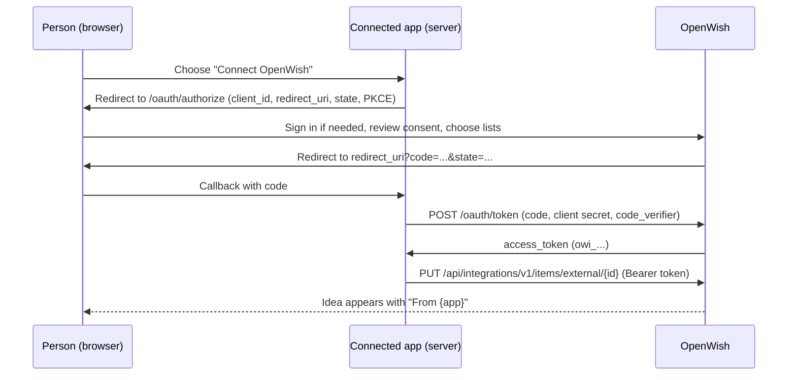

# Connected apps

Connected apps let other software you run add gift ideas to OpenWish for the
people who use both. A wardrobe tracker, a reading log, or a shopping
notebook can send "I'd love this" straight to someone's wishlist, keep it up to
date when they change it there, and take it off when they no longer want it.

Nothing is connected by default. The person who runs OpenWish registers each
app, and each person decides whether to connect it and which lists it may use.
Operators can also turn on an [MCP server](#ai-assistants-mcp) so people can
connect AI assistants such as Claude, ChatGPT, and VS Code with the same
consent screen.



## What people see

- **Consent.** The app sends the person to OpenWish, which shows who is asking,
  exactly what the app can and cannot do, and the person's own lists. They
  choose one or more lists, or start a new private list right there. New ideas
  go to the first list they choose, unless they create a new private list;
  that new list becomes the default even when existing lists are also selected.
- **Where ideas came from.** Ideas an app adds show a small "From {app}" badge
  in grid, list, and card views, for the owner and for shoppers. When the owner
  edits one, OpenWish explains that the app keeps it in sync. Privacy and
  ranking choices made in OpenWish always stay with the owner.
- **Integrations.** Copy the MCP address first, or open an available app and
  choose **Connect OpenWish** there. Each connection has a compact summary
  showing when it was last used, how many ideas it added, and where new ideas
  go. Expand **Allowed lists** to view its access, or choose **Adjust lists**
  to change access and the default destination. Search list names or show
  **Selected only** in the bounded list picker; filtering never clears a
  selection. The same picker appears during consent. Large idea collections
  appear as counts, not an extra feed of items. Forms still work without
  JavaScript; search and selected-only filtering are enhancements.
  Disconnecting stops the app immediately; ideas it added stay on the list.

### What an app can never see

An app acts only for the person who connected it, only on the lists they
chose, and only on the ideas it added itself. It never receives:

- who reserved, purchased, or commented on anything;
- ideas the person added in OpenWish or through another app;
- other people's lists, friends, events, or email addresses.

An app's token works only on `/api/integrations/v1`. It cannot sign in to
OpenWish or call the APIs the OpenWish website uses, and a signed-in browser
session cannot call the integration API.

## For operators: register an app

Registration is configuration, so it fits the way OpenWish already handles
SMTP, Google sign-in, and OpenAI. Add one numbered block per app and restart
OpenWish.

```bash
OpenWishSettings__BaseUri=https://wish.example.com/
OpenWishSettings__Integrations__Apps__0__ClientId=studio
OpenWishSettings__Integrations__Apps__0__ClientSecret=<at least 32 random characters>
OpenWishSettings__Integrations__Apps__0__DisplayName=Studio Notebook
OpenWishSettings__Integrations__Apps__0__Description=Send pieces from your wardrobe wishlist to OpenWish.
OpenWishSettings__Integrations__Apps__0__HomepageUrl=https://studio.example.com
OpenWishSettings__Integrations__Apps__0__RedirectUris__0=https://studio.example.com/api/integrations/openwish/callback
```

| Setting | Required | Notes |
|---|---|---|
| `ClientId` | Yes | 1-100 letters, digits, `.`, `_`, or `-`. Shared with the app. |
| `ClientSecret` | Yes | At least 32 characters. Generate one with `openssl rand -base64 48`. Give the same value to the app; keep it out of source control. |
| `DisplayName` | No | Shown to people on consent, badges, and settings. Defaults to `ClientId`. |
| `Description` | No | One sentence on the consent screen and in settings. |
| `HomepageUrl` | No | Lets settings offer an "Open {app}" link so people can start connecting from the app. |
| `RedirectUris__N` | Yes | Absolute callback URLs. OpenWish compares them exactly, including the path and port. |

Set `OpenWishSettings__BaseUri` to the public address of OpenWish so the links
it gives apps point to the right place behind a reverse proxy.
The proxy must preserve the public `Host` header. If relying on forwarded
scheme detection instead, configure only the actual proxy's addresses in
`ForwardedHeaders:KnownProxies` or `ForwardedHeaders:KnownNetworks`.
Do not trust arbitrary forwarded headers from the internet.

OpenWish validates each entry at startup and logs a warning instead of failing
when one is incomplete. The Integrations page remains available in the signed-in
navigation even when no app is registered, so people can find the setup guide
and see whether MCP is enabled. When no app is valid, the app OAuth endpoints
report that nothing is registered. Plain HTTP redirect URIs are accepted for
trusted home networks but logged as a warning; use HTTPS anywhere else.

For local development with Aspire, put the same keys (with `:` separators) in
the AppHost user secrets, for example
`dotnet user-secrets set "OpenWishSettings:Integrations:Apps:0:ClientId" "studio"`.
The AppHost forwards them to the web app.

To remove an app, delete its block and restart. Its tokens stop working
immediately, and its connections show "no longer set up" in each person's
settings until they disconnect. Rotating `ClientSecret` affects only the
token and revoke calls; existing connections keep working.

## AI assistants (MCP)

OpenWish can serve the [Model Context Protocol](https://modelcontextprotocol.io/)
at `/mcp`, so a person can tell their AI assistant "save that as a gift idea"
and have it land on the list they chose. The assistant uses the same consent
screen, list choices, provenance, and privacy limits as other connected apps.

It is off by default. To turn it on:

```bash
OpenWishSettings__BaseUri=https://wish.example.com/
OpenWishSettings__Integrations__Mcp__Enabled=true
# Optional: only let remote assistants redirect to these hosts.
OpenWishSettings__Integrations__Mcp__AllowedRedirectHosts__0=claude.ai
OpenWishSettings__Integrations__Mcp__AllowedRedirectHosts__1=chatgpt.com
OpenWishSettings__Integrations__Mcp__AllowedRedirectHosts__2=vscode.dev
```

Each person then finds the server address, such as
`https://wish.example.com/mcp`, under **Account settings** > **Connected apps**
and adds it to their assistant as a custom connector or remote MCP server. The
assistant opens OpenWish in a browser, the person approves it and chooses its
lists, and the assistant appears in Connected apps labeled "AI assistant".

Sign in to OpenWish with your email and password or an external sign-in provider
configured by your host, such as Google. If you're already signed in, the
connection uses that account. Check the signed-in account on the consent screen
before approving; the assistant receives its own scoped token, not your
OpenWish password or external-provider credentials.

OpenWish must be reachable over HTTPS at the root of its host name; hosted
assistants such as Claude and ChatGPT connect from their own servers, so a
home-network-only address works only for assistants running on the same
network (VS Code, Claude Code, Copilot CLI). Serving OpenWish under a path such
as `https://example.com/openwish/` is not supported for MCP, because assistants
look for OAuth metadata at the root of the host.

### Tools

| Tool | What it does |
|---|---|
| `list_wishlists` | The lists the person allowed, including the default list. |
| `list_ideas` | Ideas this assistant added, optionally on one list. |
| `add_idea` | Adds an idea with a name and optional notes, links, price, store, and priority. |
| `update_idea` | Changes only the fields passed, on an idea this assistant added. |
| `remove_idea` | Removes an idea this assistant added. |

Assistants never see reservations, purchases, comments, friends, or ideas they
did not add, and they cannot read a person's whole wishlist.

### Compatibility

| Client | Status |
|---|---|
| Claude (claude.ai, desktop, mobile) custom connectors | Supported. Uses dynamic client registration and `https://claude.ai/api/mcp/auth_callback`. |
| Claude Code | Supported. Uses a loopback redirect. |
| ChatGPT developer mode / custom connectors | Supported through dynamic client registration. Availability depends on the person's ChatGPT plan. |
| GitHub Copilot in VS Code | Supported. Uses a loopback or `vscode.dev` redirect. |
| GitHub Copilot CLI | Supported for remote HTTP servers with OAuth. |
| Copilot cloud agent, OpenAI Responses API `mcp` tool | Not supported. They send a caller-provided token and never run a person's sign-in, so there is no consent. |
| Clients with custom URL scheme redirects (for example `cursor://`) or browser-only clients | Not supported. Redirects must be HTTPS or loopback HTTP, and `/mcp` does not allow cross-origin browser requests. |

These clients and their requirements change often; the tests use the official
C# MCP SDK as the reference client, and each connection should still be tried
with the real assistant before relying on it.

### How it works

1. An unauthenticated request to `/mcp` returns `401` with
   `WWW-Authenticate: Bearer resource_metadata="https://wish.example.com/.well-known/oauth-protected-resource/mcp", scope="wishlist.items"`.
2. The protected resource metadata (RFC 9728) names `https://wish.example.com/mcp`
   as the resource and OpenWish as its authorization server.
3. The assistant reads `/.well-known/oauth-authorization-server` (RFC 8414) and
   registers itself at `POST /oauth/register` (RFC 7591). Registrations are
   public clients by default and expire after a day if never used.
4. The person approves the assistant at `/oauth/authorize`. PKCE (`S256`) is
   required, and every redirect includes `iss` (RFC 9207). When sent, the
   `resource` parameter (RFC 8707) must be exactly the `/mcp` URL; anything
   else returns `invalid_target`. Assistants that omit it still get an MCP-only
   token, because self-registered clients can only connect to `/mcp`.
5. `POST /oauth/token` returns a one-hour access token and a refresh token.
   Each refresh returns a new refresh token; reusing an old one disconnects the
   assistant (OAuth 2.0 Security BCP).

Security choices:

- Assistants name themselves, so the consent screen warns that OpenWish can't
  verify who made them and shows where it will send the person back.
- MCP tokens work only at `/mcp`, and app tokens work only on the integration
  API; neither is accepted by the other.
- Registration redirect URIs must be HTTPS or loopback HTTP, without fragments
  or credentials. A loopback redirect may use any port for the registered path
  (RFC 8252). `AllowedRedirectHosts` restricts remote hosts; loopback is always
  allowed because it only reaches the person's own computer.
- Registration is limited to 20 per hour per address, and MCP calls share the
  integration API's per-connection rate limit.
- Disconnecting from settings revokes the access and refresh tokens at once.

Each new connection from an assistant registers a new client, so reconnecting
can show the assistant more than once in Connected apps. Disconnect the ones
you no longer use.

## For app developers

This contract supports **confidential server-side clients only**: the client
secret and access token must stay on the app's server. Browser-only, native,
and public clients, dynamic registration, OpenID Connect, refresh tokens, and
arbitrary scopes are not supported for registered apps; AI assistants use the
separate [MCP flow](#ai-assistants-mcp). The only scope is `wishlist.items`.

OpenWish implements a bounded OAuth 2.0 authorization code grant (RFC 6749) with
PKCE (RFC 7636, `S256`), token revocation (RFC 7009), and authorization server
metadata (RFC 8414). Use any standard OAuth client library, or follow these
steps.

### Discover the endpoints

`GET /.well-known/oauth-authorization-server`

```json
{
  "issuer": "https://wish.example.com/",
  "authorization_endpoint": "https://wish.example.com/oauth/authorize",
  "token_endpoint": "https://wish.example.com/oauth/token",
  "revocation_endpoint": "https://wish.example.com/oauth/revoke",
  "response_types_supported": ["code"],
  "grant_types_supported": ["authorization_code"],
  "code_challenge_methods_supported": ["S256"],
  "token_endpoint_auth_methods_supported": ["client_secret_post", "client_secret_basic"],
  "scopes_supported": ["wishlist.items"],
  "openwish_api_base": "https://wish.example.com/api/integrations/v1/"
}
```

It returns 404 when no app is registered and MCP is off. When MCP is on, it
also lists `registration_endpoint`, the `refresh_token` grant, and the `none`
client authentication method that assistants use; registered apps keep using
their client secret.

### 1. Send the person to OpenWish

```text
GET /oauth/authorize
    ?response_type=code
    &client_id=studio
    &redirect_uri=https://studio.example.com/api/integrations/openwish/callback
    &state=<random value you store in the person's session>
    &code_challenge=<base64url(SHA-256(code_verifier))>
    &code_challenge_method=S256
    &scope=wishlist.items
```

`state` is required. PKCE is optional for confidential clients but strongly
recommended. When the person approves, OpenWish redirects to
`redirect_uri?code=...&state=...`. When they cancel, it redirects with
`error=access_denied`. Other protocol problems redirect with an OAuth error
code such as `invalid_request`. An unknown `client_id` or unregistered
`redirect_uri` never redirects; OpenWish shows the person an error instead.

### 2. Exchange the code from your server

```bash
curl -X POST https://wish.example.com/oauth/token \
  -d grant_type=authorization_code \
  -d code="$CODE" \
  -d redirect_uri=https://studio.example.com/api/integrations/openwish/callback \
  -d client_id=studio \
  -d client_secret="$CLIENT_SECRET" \
  -d code_verifier="$CODE_VERIFIER"
```

HTTP Basic client authentication is also accepted. A successful response is:

```json
{
  "access_token": "owi_...",
  "token_type": "Bearer",
  "scope": "wishlist.items",
  "connection_id": "6c5f..."
}
```

Codes expire after five minutes and work once. Presenting a used code again
with its matching client, redirect URI, and PKCE verifier revokes the token it
produced; an invalid verifier or redirect cannot revoke a valid connection.
Tokens do not expire on a timer; they last until
the person disconnects or you revoke them. Store the token server-side and
never send it to a browser. Errors use OAuth JSON, for example
`400 {"error":"invalid_grant"}` or `401 {"error":"invalid_client"}`.

Connecting the same person again issues a new token and keeps every idea your
app added earlier under its management.

There is one active token per person/app. Concurrent successful exchanges
rotate that token, so only the last issued token remains usable. A client
should serialize its own connection attempts and never blindly retry a code
exchange after an uncertain response; start fresh consent instead.

Disconnecting, revoking, or saving list permissions invalidates outstanding
unexchanged codes for that person/app, including when a code exchange is
already waiting to run. The old consent screen cannot reconnect a disconnected
app or restore removed list access. These mutations are serialized through a
PostgreSQL transaction advisory lock, including the first connection before a
connection row exists; code consumption and token issuance commit together.

### 3. Call the API

Send `Authorization: Bearer owi_...` to `/api/integrations/v1`. Responses use
camelCase JSON. A `401` with `WWW-Authenticate: Bearer error="invalid_token"`
means the person disconnected; forget the token and offer to reconnect.

| Method | Path | Result |
|---|---|---|
| `GET` | `/me` | Connection, app, the person's display name, and allowed lists |
| `GET` | `/wishlists` | Lists the person allowed; one has `isDefault: true` |
| `GET` | `/items?wishlistId=&externalId=` | Ideas your app added on allowed lists |
| `GET` | `/items/{id}` | One idea |
| `POST` | `/items` | Add an idea: `201`, or `409 duplicate_external_id` with `itemId` |
| `PUT` | `/items/{id}` | Update an idea: `200` |
| `PUT` | `/items/external/{externalId}` | Add or update by your own ID: `201` or `200` |
| `DELETE` | `/items/{id}` | Remove an idea: `204` |
| `DELETE` | `/items/external/{externalId}` | Remove by your own ID: `204`, or `404` |

Request body for `POST` and `PUT`:

```json
{
  "wishlistId": null,
  "externalId": "piece-42",
  "name": "Cashmere crewneck",
  "description": "Oatmeal, size S",
  "url": "https://shop.example.com/crewneck",
  "imageUrl": "https://shop.example.com/crewneck.jpg",
  "price": 129.00,
  "whereToBuy": "Example Shop",
  "priority": 1
}
```

- `name` is required (200 characters). `description` allows 4,000;
  `externalId` and `whereToBuy` allow 200.
- `url` and `imageUrl` must be absolute `http` or `https` URLs. OpenWish does
  not fetch them, but friends' browsers load `imageUrl` directly, so send only
  public image addresses.
- `price` has at most two decimal places and no currency. `priority` is `1`
  (high), `2` (medium), `3` (low), or omitted. On `PUT`, a missing or `null`
  priority keeps the current one and `0` clears it.
- Without `wishlistId`, a new idea goes to the person's default list for your
  app, including when `PUT /items/external/{externalId}` creates it. On `PUT`, a
  `wishlistId` moves the idea to another allowed list.
- `PUT` replaces the name, description, links, price, and store; a missing
  value clears it.
- `externalId` is your stable identifier. It is unique among your active
  ideas for that person, so `PUT /items/external/{externalId}` is a safe,
  repeatable sync operation.

Each idea in a response looks like:

```json
{
  "id": "9f8e...",
  "externalId": "piece-42",
  "wishlistId": "a1b2...",
  "wishlistName": "Christmas",
  "name": "Cashmere crewneck",
  "description": "Oatmeal, size S",
  "url": "https://shop.example.com/crewneck",
  "imageUrl": "https://shop.example.com/crewneck.jpg",
  "price": 129.00,
  "whereToBuy": "Example Shop",
  "priority": 1,
  "createdOn": "2026-10-20T23:00:00+00:00",
  "updatedOn": "2026-10-20T23:00:00+00:00",
  "openWishUrl": "https://wish.example.com/wishlists/a1b2..."
}
```

Other responses: `403 {"error":"wishlist_not_allowed"}` when a list is not
allowed, `404 {"error":"not_found"}`, `400` validation problem details, and
`429` when rate limited. Each connection can make bursts of 120 requests and
then about two per second.

People can delete an idea, or the whole list it is on, in OpenWish. The idea
then disappears from `GET /items`, and the next
`PUT /items/external/{externalId}` adds it again on an allowed list, so sync
only in response to a person's action in your app. For background edits, prefer
`PUT /items/{id}` and treat `404` as "the person removed it" so you don't
recreate ideas they deleted.

### Practical tips

- Register a separate `ClientId` for each environment of your app, such as
  staging and production. Ideas and `externalId` values belong to the app and
  person, so two environments sharing one `ClientId` would manage each other's
  ideas.
- OpenWish returns the person to your callback with a cross-site redirect.
  Browsers do not send `SameSite=Strict` cookies on that request, so either use
  `SameSite=Lax` for the session cookie your callback reads, or have the
  callback bounce once through a same-site page before checking `state`.

### 4. Disconnect from your app

```bash
curl -X POST https://wish.example.com/oauth/revoke \
  -d token="$ACCESS_TOKEN" -d client_id=studio -d client_secret="$CLIENT_SECRET"
```

Revocation always returns `200` for an authenticated client.

## Verification

`src/OpenWish.Web.Tests` hosts the real web app against PostgreSQL and drives a
fake connected app through consent, code exchange, adding, editing, moving,
and removing ideas, revocation, reconnection, code replay, and privacy
boundaries between people and between apps. The tests start a disposable
PostgreSQL container with Docker; set `OPENWISH_TEST_POSTGRES` to a connection
string only to use a dedicated disposable test database, never a development
or production database. Lifecycle regressions cover outstanding consent,
concurrent exchange/replay/disconnect, and moved-item activity privacy.
Proxy tests verify HTTPS discovery from trusted proxies and reject an untrusted
forwarded scheme. MCP tests use the official C# MCP SDK to discover the server
from its 401 challenge, register, approve consent, and call every tool, and
cover audience separation, refresh rotation and reuse, expiry, redirect rules,
confidential registrations, and the disabled server.

`scripts/verify-e2e.sh` registers a synthetic app named Studio Notebook and
walks the same journey in a browser, including screenshots of the consent
screen, source badges, settings, and disconnecting.
Server-only layout components can keep InteractiveAuto on server rendering, so
the browser test explicitly selects the existing Auto marker's WebAssembly
payload before Blazor starts. It then requires a real client-side
wishlist API response, checks the edit sync warning, and saves through the
cookie-authenticated public-item-ID update route without creating a duplicate.
List rendering keys and edit reconciliation use public identities rather than
the internal IDs omitted from JSON. Production render-mode selection is not changed.

For interoperability with the actual companion (not the fake app), provide a
local checkout of The Atelier:

```bash
scripts/verify-integrated-client.sh /absolute/path/to/the-atelier
```

The script runs the companion's tests in Node 20, builds both apps, and starts
a uniquely named disposable Compose network with PostgreSQL and an HTTPS
reverse proxy. No host ports, Aspire resources, or persistent review databases
are used. Synthetic logins and a test-only companion host exercise its actual
production Secure/Strict session-cookie configuration without requiring Google
sign-in. Never use this host or either verification Compose file for deployment.
The broad forwarded-network setting is safe only in this isolated test network,
not an operator configuration example.

The browser uses the actual companion's connect/callback, record CRUD, sync,
disconnect, and reconnect routes, including a real cross-site Strict-cookie
bounce. Results are saved to
`.docs/images/verification/integrated-client-result.json`.
No companion source is copied into this repository.

Validated companion source: `mitch-b/the-atelier` PR #3,
`898357f821fa2ad0f2d6b4d6cb244b11d512a1eb`.
That revision's server lockfile is out of sync with its manifest (`npm ci`
fails). The harness deliberately matches its existing production Dockerfile's
`npm install --omit=dev` behavior rather than claiming a reproducible locked
dependency build. Repairing the companion lockfile is a separate release
prerequisite in that repository.

## Protocol implementation decision

Use delegated consent for multi-user apps. A single operator API key would
erase per-person authorization, list selection, provenance, and independent
revocation. A scoped personal token could be a separate future feature for
one-person scripts; it should not replace this contract.

OpenIddict was evaluated as the maintained OAuth-server alternative:
[server setup](https://documentation.openiddict.com/guides/getting-started/creating-your-own-server-instance.html)
and [credentials](https://documentation.openiddict.com/configuration/encryption-and-signing-credentials.html).
It would introduce application/authorization/token stores and migrations,
server endpoint integration, and a production signing/encryption credential or
Data Protection key-management plan. It would still need OpenWish's consent,
list scoping, revocation ordering, and activity privacy rules.

MCP support needed public clients, refresh tokens, and self-registration.
OpenIddict 7.8 still offers neither dynamic client registration nor Client ID
Metadata Documents, which every current MCP client relies on, so adopting it
would not remove the custom protocol code. OpenWish therefore extends the
narrow contract with opaque, hashed tokens, the specific RFCs listed above,
and tests that drive the official MCP C# SDK through the whole flow. This is
not a claim of OAuth conformance certification. Revisit a maintained server
if OpenWish adds OpenID Connect, more grants or scopes, or if OpenIddict gains
registration support.
