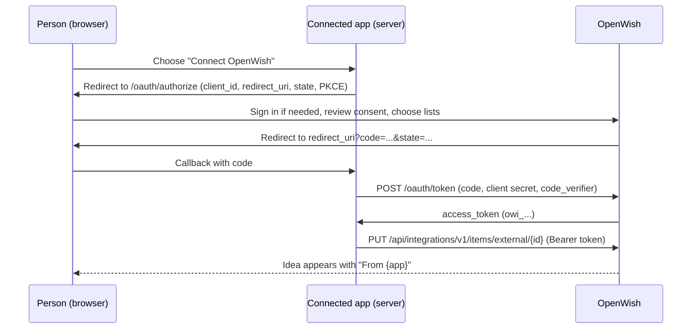

# Connected apps

Connected apps let other software you run add gift ideas to OpenWish for the
people who use both. A wardrobe tracker, a reading log, or a shopping
notebook can send "I'd love this" straight to someone's wishlist, keep it up to
date when they change it there, and take it off when they no longer want it.

Nothing is connected by default. The person who runs OpenWish registers each
app, and each person decides whether to connect it and which lists it may use.



## What people see

- **Consent.** The app sends the person to OpenWish, which shows who is asking,
  exactly what the app can and cannot do, and the person's own lists. They
  choose one or more lists, or start a new private list right there. New ideas
  go to the first list they choose.
- **Where ideas came from.** Ideas an app adds show a small "From {app}" badge
  in grid, list, and card views, for the owner and for shoppers. When the owner
  edits one, OpenWish explains that the app keeps it in sync. Privacy and
  ranking choices made in OpenWish always stay with the owner.
- **Account settings > Connected apps.** Each connection shows when it was
  connected and last used, how many ideas it added, and which lists it can use.
  People can change those lists, choose where new ideas go, or disconnect.
  Disconnecting stops the app immediately; ideas it added stay on the list.

### What an app can never see

An app acts only for the person who connected it, only on the lists they
chose, and only on the ideas it added itself. It never receives:

- who reserved, purchased, or commented on anything;
- ideas the person added in OpenWish or through another app;
- other people's lists, friends, events, or email addresses.

An app's token works only on `/api/integrations/v1`. It cannot sign in to
OpenWish or call the APIs the OpenWish website uses, and a signed-in browser
session cannot call the integration API.

## For operators: register an app

Registration is configuration, so it fits the way OpenWish already handles
SMTP, Google sign-in, and OpenAI. Add one numbered block per app and restart
OpenWish.

```bash
OpenWishSettings__BaseUri=https://wish.example.com/
OpenWishSettings__Integrations__Apps__0__ClientId=studio
OpenWishSettings__Integrations__Apps__0__ClientSecret=<at least 32 random characters>
OpenWishSettings__Integrations__Apps__0__DisplayName=Studio Notebook
OpenWishSettings__Integrations__Apps__0__Description=Send pieces from your wardrobe wishlist to OpenWish.
OpenWishSettings__Integrations__Apps__0__HomepageUrl=https://studio.example.com
OpenWishSettings__Integrations__Apps__0__RedirectUris__0=https://studio.example.com/api/integrations/openwish/callback
```

| Setting | Required | Notes |
|---|---|---|
| `ClientId` | Yes | 1-100 letters, digits, `.`, `_`, or `-`. Shared with the app. |
| `ClientSecret` | Yes | At least 32 characters. Generate one with `openssl rand -base64 48`. Give the same value to the app; keep it out of source control. |
| `DisplayName` | No | Shown to people on consent, badges, and settings. Defaults to `ClientId`. |
| `Description` | No | One sentence on the consent screen and in settings. |
| `HomepageUrl` | No | Lets settings offer an "Open {app}" link so people can start connecting from the app. |
| `RedirectUris__N` | Yes | Absolute callback URLs. OpenWish compares them exactly, including the path and port. |

Set `OpenWishSettings__BaseUri` to the public address of OpenWish so the links
it gives apps point to the right place behind a reverse proxy.

OpenWish validates each entry at startup and logs a warning instead of failing
when one is incomplete. When no app is valid, the Connected apps page is
hidden and the OAuth endpoints report that nothing is registered. Plain HTTP
redirect URIs are accepted for trusted home networks but logged as a warning;
use HTTPS anywhere else.

For local development with Aspire, put the same keys (with `:` separators) in
the AppHost user secrets, for example
`dotnet user-secrets set "OpenWishSettings:Integrations:Apps:0:ClientId" "studio"`.
The AppHost forwards them to the web app.

To remove an app, delete its block and restart. Its tokens stop working
immediately, and its connections show "no longer set up" in each person's
settings until they disconnect. Rotating `ClientSecret` affects only the
token and revoke calls; existing connections keep working.

## For app developers

OpenWish implements the OAuth 2.0 authorization code grant (RFC 6749) with
PKCE (RFC 7636, `S256`), token revocation (RFC 7009), and authorization server
metadata (RFC 8414). Use any standard OAuth client library, or follow these
steps.

### Discover the endpoints

`GET /.well-known/oauth-authorization-server`

```json
{
  "issuer": "https://wish.example.com/",
  "authorization_endpoint": "https://wish.example.com/oauth/authorize",
  "token_endpoint": "https://wish.example.com/oauth/token",
  "revocation_endpoint": "https://wish.example.com/oauth/revoke",
  "response_types_supported": ["code"],
  "grant_types_supported": ["authorization_code"],
  "code_challenge_methods_supported": ["S256"],
  "token_endpoint_auth_methods_supported": ["client_secret_post", "client_secret_basic"],
  "scopes_supported": ["wishlist.items"],
  "openwish_api_base": "https://wish.example.com/api/integrations/v1/"
}
```

It returns 404 when no app is registered.

### 1. Send the person to OpenWish

```text
GET /oauth/authorize
    ?response_type=code
    &client_id=studio
    &redirect_uri=https://studio.example.com/api/integrations/openwish/callback
    &state=<random value you store in the person's session>
    &code_challenge=<base64url(SHA-256(code_verifier))>
    &code_challenge_method=S256
    &scope=wishlist.items
```

`state` is required. PKCE is optional for confidential clients but strongly
recommended. When the person approves, OpenWish redirects to
`redirect_uri?code=...&state=...`. When they cancel, it redirects with
`error=access_denied`. Other protocol problems redirect with an OAuth error
code such as `invalid_request`. An unknown `client_id` or unregistered
`redirect_uri` never redirects; OpenWish shows the person an error instead.

### 2. Exchange the code from your server

```bash
curl -X POST https://wish.example.com/oauth/token \
  -d grant_type=authorization_code \
  -d code="$CODE" \
  -d redirect_uri=https://studio.example.com/api/integrations/openwish/callback \
  -d client_id=studio \
  -d client_secret="$CLIENT_SECRET" \
  -d code_verifier="$CODE_VERIFIER"
```

HTTP Basic client authentication is also accepted. A successful response is:

```json
{
  "access_token": "owi_...",
  "token_type": "Bearer",
  "scope": "wishlist.items",
  "connection_id": "6c5f..."
}
```

Codes expire after five minutes and work once. Presenting a used code again
revokes the token it produced. Tokens do not expire on a timer; they last until
the person disconnects or you revoke them. Store the token server-side and
never send it to a browser. Errors use OAuth JSON, for example
`400 {"error":"invalid_grant"}` or `401 {"error":"invalid_client"}`.

Connecting the same person again issues a new token and keeps every idea your
app added earlier under its management.

### 3. Call the API

Send `Authorization: Bearer owi_...` to `/api/integrations/v1`. Responses use
camelCase JSON. A `401` with `WWW-Authenticate: Bearer error="invalid_token"`
means the person disconnected; forget the token and offer to reconnect.

| Method | Path | Result |
|---|---|---|
| `GET` | `/me` | Connection, app, the person's display name, and allowed lists |
| `GET` | `/wishlists` | Lists the person allowed; one has `isDefault: true` |
| `GET` | `/items?wishlistId=&externalId=` | Ideas your app added on allowed lists |
| `GET` | `/items/{id}` | One idea |
| `POST` | `/items` | Add an idea: `201`, or `409 duplicate_external_id` with `itemId` |
| `PUT` | `/items/{id}` | Update an idea: `200` |
| `PUT` | `/items/external/{externalId}` | Add or update by your own ID: `201` or `200` |
| `DELETE` | `/items/{id}` | Remove an idea: `204` |
| `DELETE` | `/items/external/{externalId}` | Remove by your own ID: `204`, or `404` |

Request body for `POST` and `PUT`:

```json
{
  "wishlistId": null,
  "externalId": "piece-42",
  "name": "Cashmere crewneck",
  "description": "Oatmeal, size S",
  "url": "https://shop.example.com/crewneck",
  "imageUrl": "https://shop.example.com/crewneck.jpg",
  "price": 129.00,
  "whereToBuy": "Example Shop",
  "priority": 1
}
```

- `name` is required (200 characters). `description` allows 4,000;
  `externalId` and `whereToBuy` allow 200.
- `url` and `imageUrl` must be absolute `http` or `https` URLs. OpenWish does
  not fetch them, but friends' browsers load `imageUrl` directly, so send only
  public image addresses.
- `price` has at most two decimal places and no currency. `priority` is `1`
  (high), `2` (medium), `3` (low), or omitted. On `PUT`, a missing or `null`
  priority keeps the current one and `0` clears it.
- Without `wishlistId`, a new idea goes to the person's default list for your
  app, including when `PUT /items/external/{externalId}` creates it. On `PUT`, a
  `wishlistId` moves the idea to another allowed list.
- `PUT` replaces the name, description, links, price, and store; a missing
  value clears it.
- `externalId` is your stable identifier. It is unique among your active
  ideas for that person, so `PUT /items/external/{externalId}` is a safe,
  repeatable sync operation.

Each idea in a response looks like:

```json
{
  "id": "9f8e...",
  "externalId": "piece-42",
  "wishlistId": "a1b2...",
  "wishlistName": "Christmas",
  "name": "Cashmere crewneck",
  "description": "Oatmeal, size S",
  "url": "https://shop.example.com/crewneck",
  "imageUrl": "https://shop.example.com/crewneck.jpg",
  "price": 129.00,
  "whereToBuy": "Example Shop",
  "priority": 1,
  "createdOn": "2026-10-20T23:00:00+00:00",
  "updatedOn": "2026-10-20T23:00:00+00:00",
  "openWishUrl": "https://wish.example.com/wishlists/a1b2..."
}
```

Other responses: `403 {"error":"wishlist_not_allowed"}` when a list is not
allowed, `404 {"error":"not_found"}`, `400` validation problem details, and
`429` when rate limited. Each connection can make bursts of 120 requests and
then about two per second.

People can delete an idea, or the whole list it is on, in OpenWish. The idea
then disappears from `GET /items`, and the next
`PUT /items/external/{externalId}` adds it again on an allowed list, so sync
only in response to a person's action in your app. For background edits, prefer
`PUT /items/{id}` and treat `404` as "the person removed it" so you don't
recreate ideas they deleted.

### Practical tips

- Register a separate `ClientId` for each environment of your app, such as
  staging and production. Ideas and `externalId` values belong to the app and
  person, so two environments sharing one `ClientId` would manage each other's
  ideas.
- OpenWish returns the person to your callback with a cross-site redirect.
  Browsers do not send `SameSite=Strict` cookies on that request, so either use
  `SameSite=Lax` for the session cookie your callback reads, or have the
  callback bounce once through a same-site page before checking `state`.

### 4. Disconnect from your app

```bash
curl -X POST https://wish.example.com/oauth/revoke \
  -d token="$ACCESS_TOKEN" -d client_id=studio -d client_secret="$CLIENT_SECRET"
```

Revocation always returns `200` for an authenticated client.

## Verification

`src/OpenWish.Web.Tests` hosts the real web app against PostgreSQL and drives a
fake connected app through consent, code exchange, adding, editing, moving,
and removing ideas, revocation, reconnection, code replay, and privacy
boundaries between people and between apps. The tests start a disposable
PostgreSQL container with Docker; set `OPENWISH_TEST_POSTGRES` to a connection
string to use an existing server instead.

`scripts/verify-e2e.sh` registers a synthetic app named Studio Notebook and
walks the same journey in a browser, including screenshots of the consent
screen, source badges, settings, and disconnecting.
