#  OpenWish

**Thoughtful gift giving, without duplicate purchases or spoiled surprises.**

OpenWish is a self-hosted home for the wishlists, private gift coordination,
and name draws that make a small group's celebrations feel easy. Keep the
planning with the people you trust—not a marketplace, ad network, or public
profile.

[See the features](#what-makes-openwish-different) ·
[Take the tour](#a-tour-of-one-gift-season) ·
[Run it yourself](#installation) ·
[See how it is built](.docs/DEVELOPING.md)

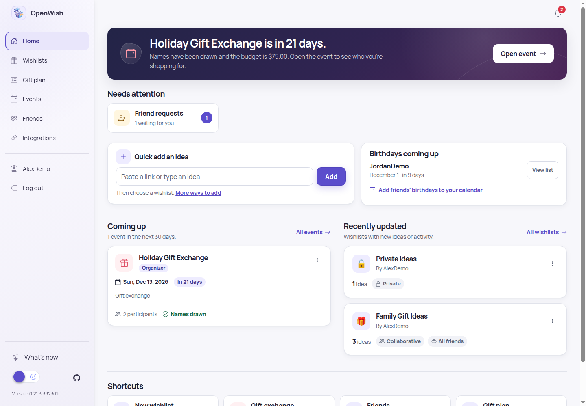

## What makes OpenWish different

**Surprises stay surprises**

- Reservations and purchases are never shown to the person receiving the
  gift. Shoppers can also reserve anonymously, hiding their name from other
  shoppers. Item comments are visible to everyone who can see the item,
  including the list owner.
- A private gift history gently warns you before you give someone the same
  gift twice.
- Viewer-specific privacy protects private lists, sharing choices, and
  name-draw assignments. Connected apps never see reservations, purchases, or
  comments.

**Gift exchanges that run themselves**

- Create an event for a holiday, birthday, or team tradition, with a date,
  budget, and an organizer checklist that always shows the next step.
- Invite friends, whole circles, or any email address. Invitees can join with
  an account or as a guest with no account at all.
- Draw names privately with optional pairing rules, such as keeping partners
  from drawing each other. Each person unwraps only their own match.
- After the occasion, reveal who drew whom to the group, then "Run it again"
  next year without repeating last year's pairings when possible.
- Add events to your calendar and get branded invitation, draw, and reminder
  emails when SMTP is configured.

**Wishlists that are faster than a notes app**

- Paste a product link from almost any store: OpenWish fills in the name,
  price, image, and store. Add ideas from your phone's share sheet when
  installed, from a bookmarklet, or by typing a quick note.
- Rank ideas, mark what is most wanted, set priorities, and organize many
  ideas at once: move, copy, archive, or mark them received.
- Share a list privately, with every friend, with chosen friends or circles,
  or with an event. Collaborative lists let others add ideas too.
- Gift hints share sizes, favorites, and things to avoid. Shoppers can filter
  a list by their exchange budget.
- Copy a list as text, print it, or download it as CSV. Export and import
  every list you own as JSON.

**Shopping that stays organized**

- "My gift plan" gathers everything you reserved by person and occasion, with
  budgets, over-budget flags, bought and wrapped progress, and a copyable
  shopping list.
- The dashboard surfaces what needs you now: invitations, friend requests,
  gifts still to buy, names to draw, and upcoming birthdays, which you can
  download to your calendar.

**Friends, not followers**

- Connect by request, email invitation, or in person with a short-lived code
  and QR code. Suggestions come only from people you already share with.
- Group friends into circles, like Family or Book club, to share lists or
  invite people to events in one step.
- In-app notifications let you mark each one read only when you are done.

**Connected apps and AI assistants**

- Let apps you trust add, update, and remove ideas on only the lists you
  choose, labeled with where each idea came from.
- Operators can turn on an MCP server so people can ask an AI assistant such
  as Claude, ChatGPT, or Copilot to save gift ideas. See
  [connected apps](.docs/INTEGRATIONS.md).

**Yours to run**

- Install it as an app on phones and computers, with an offline page, light
  and dark themes, and a layout checked at phone, tablet, and desktop widths.
- Self-host the published Docker image with your own PostgreSQL database.
  Sign in with a password, optional Google sign-in, and two-factor
  authentication.
- "What's new" in the app explains each release in plain language.

## A tour of one gift season

These screenshots follow a fictional group planning a holiday exchange: Alex
organizes, Jordan and Taylor shop, and a guest joins without an account. They
use synthetic data generated by the committed browser journey—never real user
information.

### Start with an idea, not a spreadsheet

Save useful details as soon as you have them: a product link, a price, where
to buy it, and how much it matters. Search, filters, and ranking keep a
growing list useful when the moment to shop arrives.

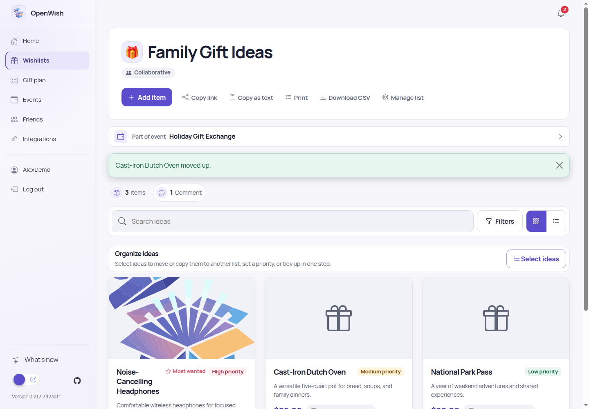

Gift hints tell shoppers what fits and what to avoid, right above the ideas.

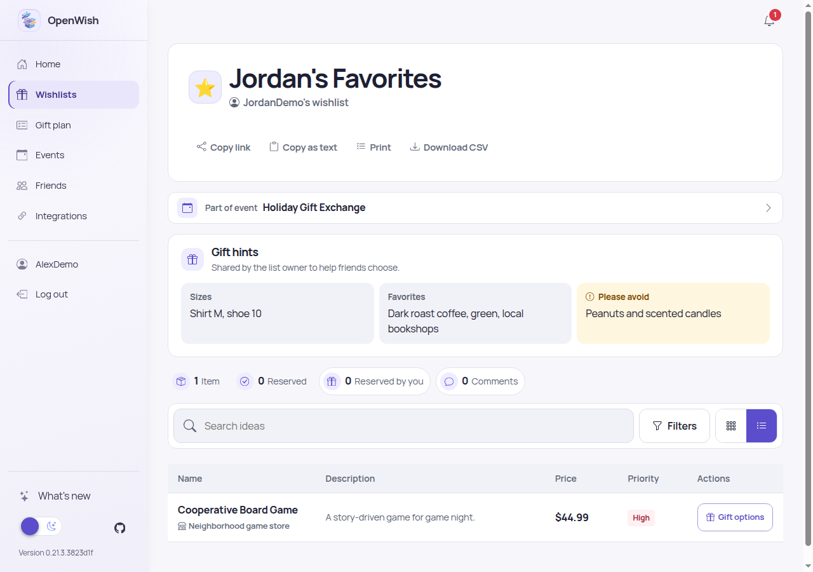

### Turn a group plan into a private exchange

The organizer checklist shows what is done and what comes next: invite the
group, collect wishlists, check readiness, and make assignments.

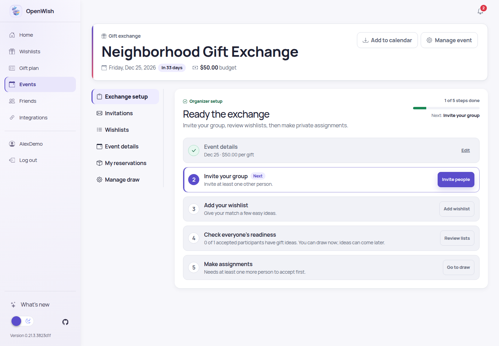

Guests can join from an invitation link without creating an account. Their
email stays private, and they only ever see their own match.

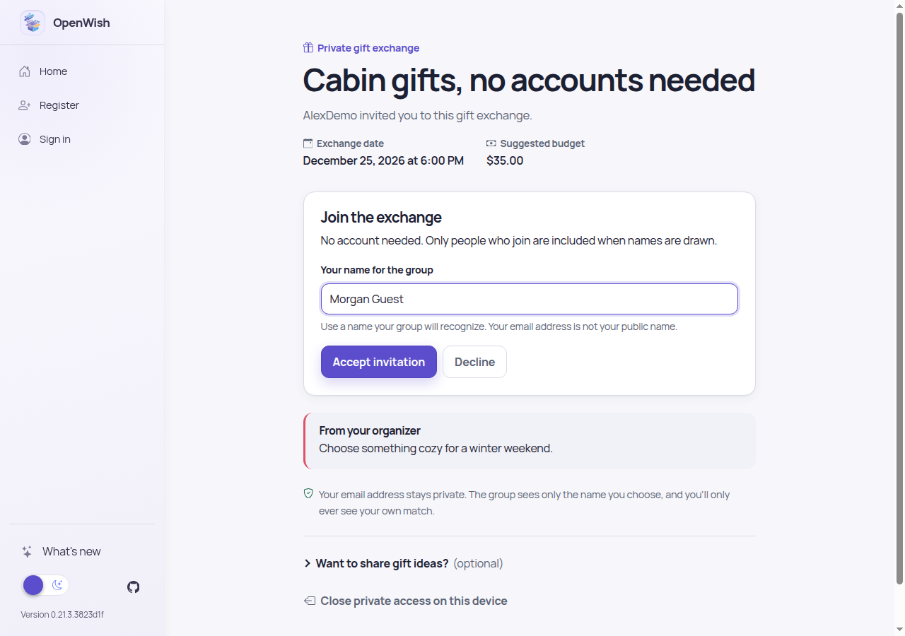

Once names are drawn, each participant sees who they are shopping for, the
suggested budget, and a shortcut to ideas within it.

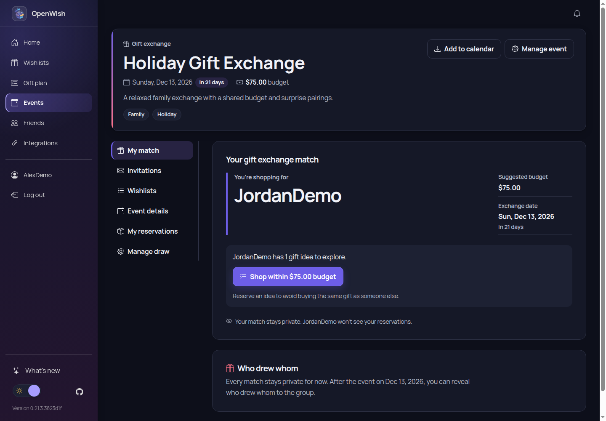

### Shop together without giving the game away

Reserve an idea, optionally anonymously, and ask other shoppers a question.
The list owner never sees reservations, and OpenWish warns you if you have
already given something similar.

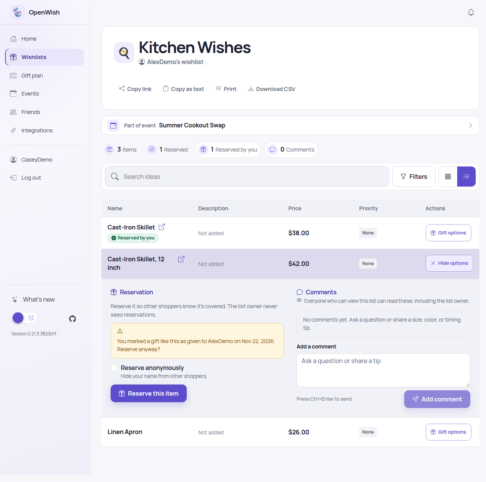

Your gift plan keeps every reserved gift in one private place, grouped by
person with budgets and progress.

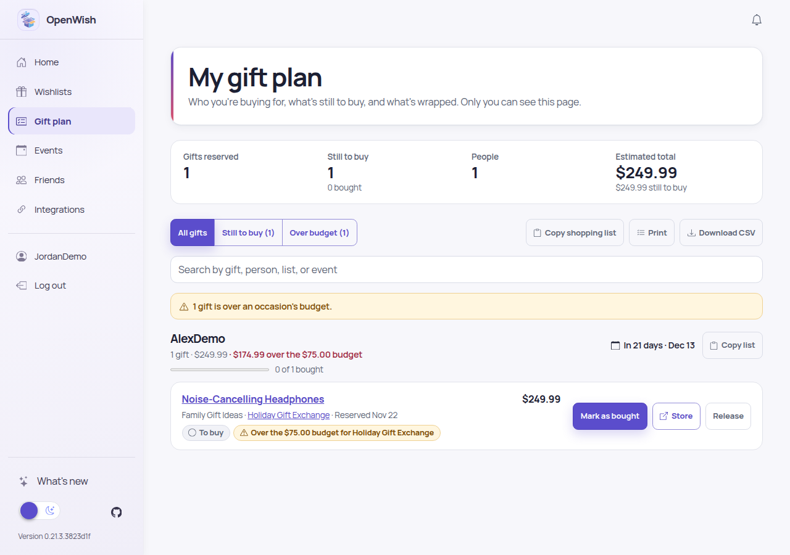

### Share with the right people

Circles group friends so you can share a list or invite people to an event in
one step.

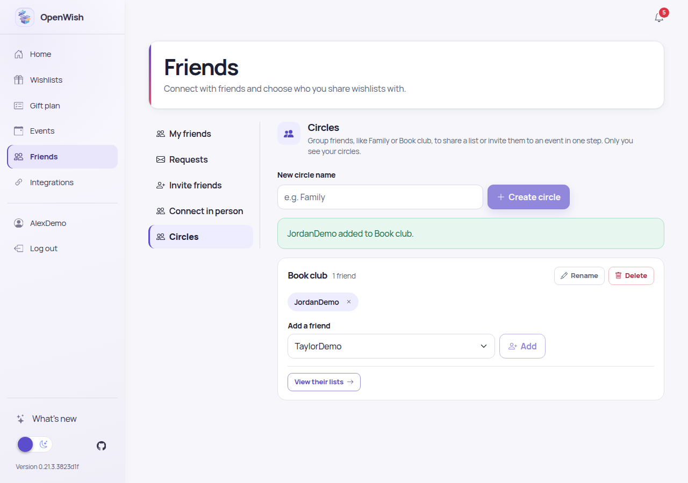

### Bring ideas from your other apps

Connect an AI assistant or a trusted app, choose which lists it may use, and
disconnect it whenever you like.

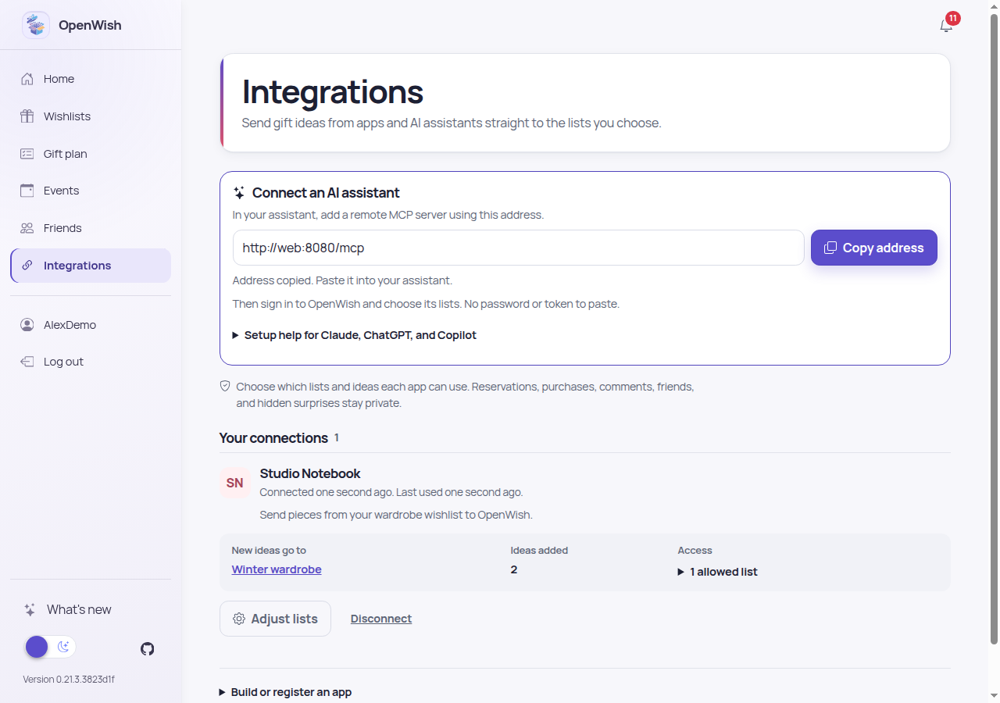

### Built for the phone in a store aisle

The same lists, matches, and quick capture work on a phone, in light or dark.

<table>
  <tr>
    <td>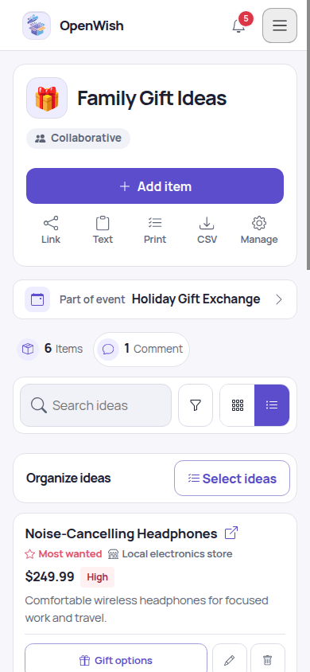</td>
    <td>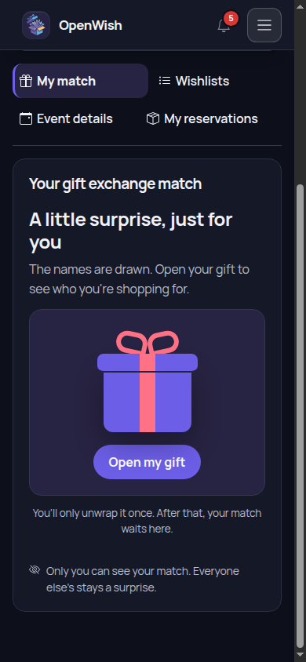</td>
    <td>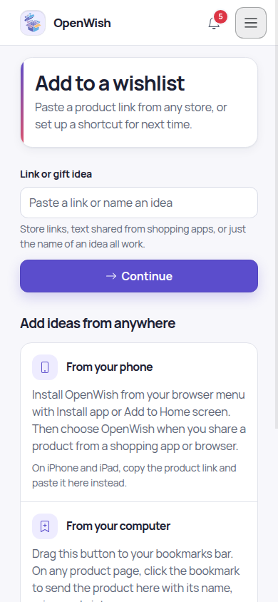</td>
  </tr>
</table>

## Built with dependable, portable tools

OpenWish is an ASP.NET Core [.NET 11](https://dot.net/) application with Blazor
server rendering and interactive WebAssembly, PostgreSQL via Entity Framework
Core, and published Docker images. It is designed to be understandable to the
person who runs it as well as useful to the people who use it.

Docker images are [published on GitHub](https://github.com/mitch-b/OpenWish/pkgs/container/openwish-web).

## Developing

[](https://codespaces.new/mitch-b/OpenWish)

See the [development guide](.docs/DEVELOPING.md) for local setup, automated
browser verification, and the isolated agent-managed environment. Read
[`PRODUCT_DIRECTION.md`](PRODUCT_DIRECTION.md) for the principles used to
evaluate contributions.

## Installation

### Docker Compose

Since OpenWish depends on an external datasource (PostgreSQL), if you don't already have a PostgreSQL instance to use, you can run an instance alongside the OpenWish application using Docker Compose:

```yaml
services:
  sql:
    image: postgres:18
    container_name: openwish-postgres
    environment:
      POSTGRES_USER: "openwish"
      POSTGRES_PASSWORD: "YourStrong!Passw0rd"
      POSTGRES_DB: "OpenWish"
    volumes:
      - openwish-data:/var/lib/postgresql
    ports:
      - 5432:5432

  web:
    image: ghcr.io/mitch-b/openwish-web:latest
    container_name: openwish-web
    environment:
      - TZ=America/Chicago
      - ConnectionStrings__OpenWish=Server=sql;Port=5432;Database=OpenWish;User Id=openwish;Password=YourStrong!Passw0rd;
      - OpenWishSettings__OwnDatabaseUpgrades=true
    ports:
      - 5001:8080
    depends_on:
      - sql

volumes:
  openwish-data:
```

See [package versions](https://github.com/mitch-b/OpenWish/pkgs/container/openwish-web/versions) for published tags. Use `{year}{month}` tags (for example, `202601`) to manage upgrades.

## License

This project is licensed under the Apache License 2.0 - see the [LICENSE](LICENSE) file for details.
